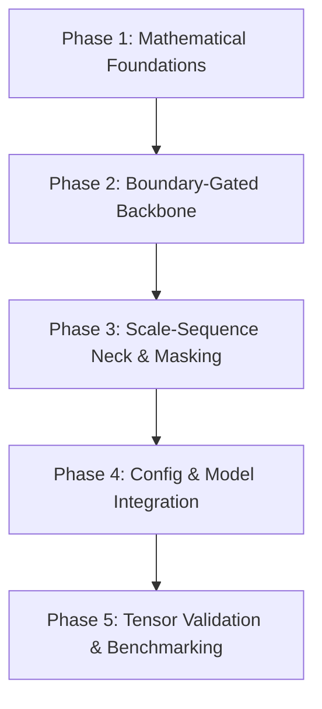

# Architecture Upgrade Proposal and Phased Update Flow: UAVDet V1
**Project Working Title:** Boundary-Aware Adaptive Deformable Mamba (BA-AD-Mamba / CAMINO / Scale-Boundary Mamba)  
*Note: The official naming of this architecture is provisional and can be adjusted as preferred.*

---

## 1. Executive Summary & Codebase Grounding

This document outlines the formal technical proposal and phased update flow to upgrade the **UAVDet** repository to **Version 1** of our custom architecture, as specified in `CAMINO_UAVDET_UPGRADE_SPEC.md` and informed by the Phase 1 Capstone Research (`CAPSTONE_REPORT/Review3_PHASE1/main.tex`).

### Current Codebase Reality Check (No Hallucinations)
A comprehensive inspection of the UAVDet repository reveals the existing baseline structure:
- **Baseline Framework:** Built on MMDetection 3.x (`mmdet`).
- **Baseline Backbone:** `CSPUAV` in [`mmdet/models/backbones/cspuav.py`](file:///d:/_CAPSTONE/UAV-DET/mmdet/models/backbones/cspuav.py), configured with `arch='P5'`, `widen_factor=0.75`, `deepen_factor=0.67`. The stem utilizes a standard 3-layer convolutional downsampler (stride 2), outputting stages at strides 4, 8, 16, and 32.
- **Baseline Neck:** `CSPMBFPN` in [`mmdet/models/necks/cspmb_fpn.py`](file:///d:/_CAPSTONE/UAV-DET/mmdet/models/necks/cspmb_fpn.py), taking 4 backbone stages (`in_channels=[192, 192, 96, 96]`) and outputting 3 multi-scale pyramid levels with `out_channels=96`. It utilizes hybrid blocks combining CSP bottlenecks and `VSSBlock` (Mamba SS2D).
- **Baseline Head:** `RTMDetSepBNHead` in [`mmdet/models/dense_heads/rtmdet_head.py`](file:///d:/_CAPSTONE/UAV-DET/mmdet/models/dense_heads/rtmdet_head.py), anchored to 3 prediction strides: **D2 (stride 4)**, **D3 (stride 8)**, and **D4 (stride 16)**.
- **Baseline Mamba Implementation:** `SS2D` in [`mmdet/models/layers/mamba_yolo.py`](file:///d:/_CAPSTONE/UAV-DET/mmdet/models/layers/mamba_yolo.py) backed by `cross_selective_scan` in [`mmdet/models/layers/common_utils_mbyolo.py`](file:///d:/_CAPSTONE/UAV-DET/mmdet/models/layers/common_utils_mbyolo.py). Low-level CUDA acceleration relies on `selective_scan_cuda_core`, with a pure PyTorch reference loop in [`selective_scan/test_selective_scan.py`](file:///d:/_CAPSTONE/UAV-DET/selective_scan/test_selective_scan.py).
- **Environment Context:** Local environment is currently executing on PyTorch 2.8.0+cpu without a CUDA compiler active. Therefore, all proposed Mamba mathematical modifications must provide a clean, high-performance **native PyTorch autograd path** alongside any compiled CUDA kernel interfaces.

---

## 2. Detailed Technical Depiction of Proposed Architectural Changes

```
                                  [ Input Image: 3 x H x W ]
                                              |
                     +------------------------+------------------------+
                     |                                                 |
         [ Multi-Scale LoG Prior ]                           [ Overlapping Patch Embed ]
       $\sigma \in \{1.0, 2.0, 4.0\}$                        7x7 Conv, Stride 4, Pad 3
      Outputs Structural Boundary Maps                                 |
                     |                                       Tokens: C_1 x (H/4) x (W/4)
                     +------------------------+                        |
                                              |                        |
                                              v                        v
                                    +------------------------------------+
                                    |    Boundary-Gated Mamba Backbone   |
                                    |               (BG-SS2D)            |
                                    | $h_t = g_t \odot (\bar{A}h_{t-1})  |
                                    |       + \bar{B}x_t                 |
                                    | Memory flushed at target boundaries|
                                    +------------------------------------+
                                              |
               ---------------------------------------------------------------
               | Stage 1: H/4 x W/4     | Stage 2: H/8 x W/8   | Stage 3: H/16 x W/16   | Stage 4: H/32 x W/32
               | Channels: 192          | Channels: 192        | Channels: 96           | Channels: 96
               ---------------------------------------------------------------
                                              |
                                              v
                                    +------------------------------------+
                                    |    Scale-Sequence Mamba Neck       |
                                    | Scan: Coarse (S4) -> Fine (S1)     |
                                    | Ingests Macro Context -> Fine Cues |
                                    +------------------------------------+
                                              |
                                              v
                                    +------------------------------------+
                                    |    Density-Guided Spatial Mask     |
                                    | 1x1 Conv -> Heatmap M in [0, 1]    |
                                    | Zeroes empty background / ocean    |
                                    +------------------------------------+
                                              |
                                              v
                                    [ Modulated Features ]
                                   F'_i = F_i \odot M_i
                                              |
                                              v
                              +---------------+---------------+
                              |               |               |
                              v               v               v
                           Head D2         Head D3         Head D4
                         (Stride 4)      (Stride 8)      (Stride 16)
```

---

### Module 1: Overlapping Patch Embedding & Spatio-Frequency (LoG Prior) Input

#### 1.1 Overlapping Patch Embedding
* **Problem in Baseline:** Non-overlapping patch embedding (e.g., rigid $4 \times 4$ patches with stride 4) slices tiny objects ($<16\times 16$ pixels) right across patch boundaries, creating arbitrary edge discontinuities.
* **Proposed Design:**
  - Implement `OverlappingPatchEmbed` using a 2D convolution with kernel size $7 \times 7$, stride $4$, and padding $3$.
  - Given an input tensor $X \in \mathbb{R}^{B \times 3 \times H \times W}$, the output spatial dimension is:
    $$H_{\text{out}} = \left\lfloor \frac{H + 2(3) - 7}{4} \right\rfloor + 1 = \frac{H}{4}, \quad W_{\text{out}} = \frac{W}{4}$$
  - For $H = W = 640$, the output is $(B, C_{\text{embed}}, 160, 160)$. The 3-pixel overlap provides contiguous spatial context across patch transitions, preventing object fragmentation.

#### 1.2 Spatio-Frequency Laplacian of Gaussian (LoG) Prior
* **Mathematical Formulation:**
  Following scale-space theory, the isotropic 2D Gaussian filter at scale $\sigma$ is:
  $$G(x, y; \sigma) = \frac{1}{2\pi\sigma^2} \exp\left(-\frac{x^2 + y^2}{2\sigma^2}\right)$$
  The scale-normalized Laplacian of Gaussian response is:
  $$\nabla^2_{\text{norm}} G(x, y; \sigma) = \sigma^2 \left( \frac{\partial^2 G}{\partial x^2} + \frac{\partial^2 G}{\partial y^2} \right) * I(x, y)$$
* **Proposed Implementation:**
  - Build a non-trainable (or fine-tunable) multi-scale convolution module `MultiScaleLoGFilter` initialized with exact analytical LoG kernels for $\sigma \in \{1.0, 2.0, 4.0\}$.
  - Kernel half-widths are set to $3\sigma$, resulting in kernel sizes $k \in \{7, 13, 25\}$.
  - Input RGB image is converted to luminance $Y = 0.299R + 0.587G + 0.114B$.
  - Filtering produces a 3-channel structural feature map $\mathcal{F}_{\text{LoG}} \in \mathbb{R}^{B \times 3 \times H \times W}$.
  - The LoG prior undergoes a parallel lightweight downsampling pyramid (using strided depthwise convolutions or average pooling) to produce scale-matched boundary priors for Stage 1 ($160\times 160$), Stage 2 ($80\times 80$), Stage 3 ($40\times 40$), and Stage 4 ($20\times 20$).

---

### Module 2: Boundary-Gated State-Space Backbone (BG-SS2D)

* **Problem in Baseline:** Standard selective state-space scanning unrolls the 2D image into 1D sequences. In aerial images with $>90\%$ background clutter, the continuous recurrent state $h_t$ accumulates noise from empty fields, tarmac, and sea, which "bleeds" into and contaminates small target features.
* **Target Recurrence Math:**
  $$h_t = g_t \odot (\overline{A}_t h_{t-1}) + \overline{B}_t x_t, \quad y_t = \overline{C}_t h_t + \overline{D}_t x_t$$
  where:
  - $\overline{A}_t = \exp(\Delta_t A)$ is the discretized state transition matrix.
  - $g_t \in [0, 1]$ is the learned boundary retention probability gate.
* **Mechanism of the Boundary Gate ($g_t$):**
  - **Flat / Background Region:** The LoG structural prior is near zero; the network learns $g_t \approx 1$, allowing long-range recurrent memory accumulation.
  - **Sharp Object Boundary Crossing:** The LoG prior displays a high-magnitude zero-crossing spike; the network predicts $g_t \to 0$.
  - **Memory Flush:** Setting $g_t \to 0$ flushes the hidden state ($g_t \odot \overline{A}_t h_{t-1} = 0$), trapping context strictly within target boundaries and preventing inter-target interference in dense clusters.
* **Tensor Dimensionality & Alignment:**
  - For a stage of spatial size $(H_i, W_i)$ and channel dimension $D$:
  - Spatial token feature: $x \in \mathbb{R}^{B \times D \times H_i \times W_i}$.
  - LoG prior at this scale: $\text{LoG}_i \in \mathbb{R}^{B \times C_{\text{LoG}} \times H_i \times W_i}$.
  - Boundary gate generator: A lightweight $1 \times 1$ conv + depthwise $3 \times 3$ conv + Sigmoid activation:
    $$G_{\text{spatial}} = \sigma\left(\text{Conv}_{3\times 3}(\text{Conv}_{1\times 1}(\text{LoG}_i))\right) \in \mathbb{R}^{B \times 1 \times H_i \times W_i} \quad \text{(or channel-wise } \mathbb{R}^{B \times D \times H_i \times W_i}\text{)}$$
  - In `CrossScan`, 4 traversal sequences of length $L = H_i W_i$ are created (horizontal forward, vertical forward, horizontal backward, vertical backward).
  - The gate map $G_{\text{spatial}}$ is scanned using the exact same 4 traversal permutations, yielding:
    $$g \in \mathbb{R}^{B \times 4 \times D \times L}$$
  - During recurrence, $g[:, k, :, t]$ is element-wise multiplied with $\overline{A}_t h_{t-1}$ at every time-step $t$.

---

### Module 3: Density-Guided Coarse-to-Fine Scale-Sequence Neck

* **Problem in Baseline:** The baseline `CSPMBFPN` uses standard bidirectional lateral connections. While effective, it processes scales mostly in localized 2D pairs rather than treating scale as a continuous semantic dimension.
* **Proposed Design:**
  - Replace `CSPMBFPN` with `ScaleSequenceMambaNeck`.
  - Ingest 4 backbone stages:
    - Stage 1: $160 \times 160$, 192 channels
    - Stage 2: $80 \times 80$, 192 channels
    - Stage 3: $40 \times 40$, 96 channels
    - Stage 4: $20 \times 20$, 96 channels
  - **Channel Projection:** Project all 4 stages to neck dimension $C_{\text{neck}} = 96$ via $1 \times 1$ convolutions: $\{X_1, X_2, X_3, X_4\}$.
  - **Sequential Scale Traversal (Coarse to Fine):**
    - The scan order is organized along the scale axis: $\text{Stage 4} \to \text{Stage 3} \to \text{Stage 2} \to \text{Stage 1}$.
    - Each stage's 2D tokens are flattened:
      - $L_4 = 20 \times 20 = 400$ tokens
      - $L_3 = 40 \times 40 = 1,600$ tokens
      - $L_2 = 80 \times 80 = 6,400$ tokens
      - $L_1 = 160 \times 160 = 25,600$ tokens
    - Macro-environmental context from Stage 4 is processed first, filling the Mamba recurrent state with global semantic understanding before advancing into high-resolution fine tokens ($X_1$).
  - **Scale Reconstruction:** After sequence traversal, the unified sequence is sliced back into spatial grids and refined through local residual convolutions, producing the 3 output levels:
    - Level 0 (stride 4, $160 \times 160$, 96 channels) $\to$ Head D2
    - Level 1 (stride 8, $80 \times 80$, 96 channels) $\to$ Head D3
    - Level 2 (stride 16, $40 \times 40$, 96 channels) $\to$ Head D4

---

### Module 4: Density-Guided Spatial Masking

* **Problem in Baseline:** In aerial images, $>90\%$ of the scene is uninformative background (sea, desert, uniform pavement). Dense anchor-free prediction heads evaluate every single anchor point across all scales, leading to false-positive "ghost predictions" in background regions that must be suppressed by post-processing NMS.
* **Proposed Design:**
  - Positioned immediately after the neck outputs and directly before entering prediction heads D2, D3, D4.
  - For each neck output feature $P_i \in \mathbb{R}^{B \times 96 \times H_i \times W_i}$, attach a lightweight density estimation branch:
    $$M_i = \sigma\left(\text{Conv}_{1\times 1}(\text{SiLU}(\text{Conv}_{3\times 3}^{\text{DW}}(P_i)))\right) \in [0, 1]^{B \times 1 \times H_i \times W_i}$$
  - **Modulation Step:**
    $$F'_i = P_i \odot M_i$$
  - In empty regions where target density is 0, feature activations are suppressed to 0. Dense classification and regression logits in those regions remain below the detection threshold, completely eliminating ghost proposals before NMS.

---

## 3. Tensor Dimensionality & Reshaping Map

Below is the verified tensor flow through the proposed architecture for a batch size of $B=2$ and input resolution $640 \times 640$:

| Component | Layer / Operation | Input Tensor Shape | Output Tensor Shape | Notes / Stride |
| :--- | :--- | :--- | :--- | :--- |
| **Input** | RGB Image | — | `(2, 3, 640, 640)` | Stride 1 |
| **LoG Prior** | `MultiScaleLoGFilter` | `(2, 3, 640, 640)` | `(2, 3, 640, 640)` | $\sigma \in \{1.0, 2.0, 4.0\}$ |
| **Patch Embed** | `OverlappingPatchEmbed` (7x7, s4, p3) | `(2, 3, 640, 640)` | `(2, 96, 160, 160)` | Stride 4 |
| **Backbone S1** | Boundary-Gated Mamba Stage 1 | `(2, 96, 160, 160)` | `(2, 192, 160, 160)` | Stride 4, $L=25600$ |
| **Backbone S2** | Downsample + BG-SS2D Stage 2 | `(2, 192, 160, 160)` | `(2, 192, 80, 80)` | Stride 8, $L=6400$ |
| **Backbone S3** | Downsample + BG-SS2D Stage 3 | `(2, 192, 80, 80)` | `(2, 96, 40, 40)` | Stride 16, $L=1600$ |
| **Backbone S4** | Downsample + BG-SS2D Stage 4 | `(2, 96, 40, 40)` | `(2, 96, 20, 20)` | Stride 32, $L=400$ |
| **Neck Proj** | 1x1 Convs to uniform $C=96$ | S1..S4 | 4 tensors of ch 96 | Spatial dims unchanged |
| **Scale Seq** | Coarse-to-fine scan (S4 $\to$ S1) | Flattened tokens | `(2, 34000, 96)` | Total tokens: $400+1600+6400+25600$ |
| **Neck Out** | Reshape & refine | `(2, 34000, 96)` | P1: `(2, 96, 160, 160)`<br>P2: `(2, 96, 80, 80)`<br>P3: `(2, 96, 40, 40)` | Output 3 levels |
| **Density Mask** | 1x1 Conv + Sigmoid | P1, P2, P3 | M1: `(2, 1, 160, 160)`<br>M2: `(2, 1, 80, 80)`<br>M3: `(2, 1, 40, 40)` | Heatmaps in $[0, 1]$ |
| **Modulation** | Element-wise $P_i \odot M_i$ | P1..P3, M1..M3 | F'1: `(2, 96, 160, 160)`<br>F'2: `(2, 96, 80, 80)`<br>F'3: `(2, 96, 40, 40)` | Feeds directly to Heads |
| **Head D2** | `RTMDetSepBNHead` (Stride 4) | `(2, 96, 160, 160)` | Cls: `(2, 10, 160, 160)`<br>Reg: `(2, 4, 160, 160)` | Sub-16px Tiny targets |
| **Head D3** | `RTMDetSepBNHead` (Stride 8) | `(2, 96, 80, 80)` | Cls: `(2, 10, 80, 80)`<br>Reg: `(2, 4, 80, 80)` | 16-32px Small targets |
| **Head D4** | `RTMDetSepBNHead` (Stride 16) | `(2, 96, 40, 40)` | Cls: `(2, 10, 40, 40)`<br>Reg: `(2, 4, 40, 40)` | >32px Medium targets |

---

## 4. Codebase Mapping & Update Flow

To ensure complete stability, changes will be implemented in dedicated, cleanly modularized files without breaking the existing `CSPUAV` or `CSPMBFPN` implementations.

```
UAV-DET/
├── mmdet/models/
│   ├── layers/
│   │   ├── log_prior.py              <-- [NEW] MultiScaleLoGFilter & OverlappingPatchEmbed
│   │   ├── boundary_gated_ss2d.py    <-- [NEW] Gated SS2D with $g_t$ flushing logic
│   │   └── common_utils_mbyolo.py    <-- [EXTENDED] Add PyTorch-gated selective scan loop
│   ├── backbones/
│   │   ├── boundary_mamba.py         <-- [NEW] BoundaryAwareMambaBackbone (4 stages)
│   │   └── __init__.py               <-- [REGISTER] Register new backbone class
│   ├── necks/
│   │   ├── scale_sequence_neck.py    <-- [NEW] ScaleSequenceMambaNeck + DensityMask
│   │   └── __init__.py               <-- [REGISTER] Register new neck class
├── configs/uavdet/
│   ├── uavdet_upgrade_visdrone.py    <-- [NEW] Full upgrade config referencing new modules
```

### Phased Update Flow



#### Phase 1: Mathematical Foundations & Unit Kernels
* Create [`mmdet/models/layers/log_prior.py`](file:///d:/_CAPSTONE/UAV-DET/mmdet/models/layers/log_prior.py):
  - Implement `MultiScaleLoGFilter` with precomputed analytical normalized LoG weights for $\sigma \in \{1.0, 2.0, 4.0\}$.
  - Implement `OverlappingPatchEmbed` ($7 \times 7$, stride 4, padding 3).
* Create [`mmdet/models/layers/boundary_gated_ss2d.py`](file:///d:/_CAPSTONE/UAV-DET/mmdet/models/layers/boundary_gated_ss2d.py):
  - Implement boundary probability projection from LoG prior.
  - Implement native PyTorch selective scan recurrence incorporating $h_t = g_t \odot (\overline{A}_t h_{t-1}) + \overline{B}_t x_t$.

#### Phase 2: Boundary-Aware Backbone Construction
* Create [`mmdet/models/backbones/boundary_mamba.py`](file:///d:/_CAPSTONE/UAV-DET/mmdet/models/backbones/boundary_mamba.py):
  - Assemble the 4 hierarchical stages using boundary-gated Mamba blocks.
  - Connect LoG prior downsampling pyramid across stages.
  - Register in [`mmdet/models/backbones/__init__.py`](file:///d:/_CAPSTONE/UAV-DET/mmdet/models/backbones/__init__.py).

#### Phase 3: Scale-Sequence Neck & Density Masking
* Create [`mmdet/models/necks/scale_sequence_neck.py`](file:///d:/_CAPSTONE/UAV-DET/mmdet/models/necks/scale_sequence_neck.py):
  - Ingest stages 1 to 4, project channels to uniform 96.
  - Implement coarse-to-fine sequence traversal (Stage 4 $\to$ Stage 1).
  - Implement `DensitySpatialMask` branch ($1 \times 1$ conv + Sigmoid) modulating output features.
  - Register in [`mmdet/models/necks/__init__.py`](file:///d:/_CAPSTONE/UAV-DET/mmdet/models/necks/__init__.py).

#### Phase 4: Config & Pipeline Assembly
* Create [`configs/uavdet/uavdet_upgrade_visdrone.py`](file:///d:/_CAPSTONE/UAV-DET/configs/uavdet/uavdet_upgrade_visdrone.py):
  - Replace `backbone` with the new boundary-aware backbone.
  - Replace `neck` with `ScaleSequenceMambaNeck`.
  - Maintain baseline `RTMDetSepBNHead` on strides 4, 8, 16.

#### Phase 5: Verification & Sanity Checks
* Execute synthetic forward passes with dummy tensors `torch.randn(2, 3, 640, 640)`.
* Verify exact shape compatibility at all junctions:
  - LoG downsampling matches backbone spatial resolutions.
  - Gated recurrence handles sequence length and batching without memory explosion.
  - Neck delivers exactly 3 levels of shape `(B, 96, 160, 160)`, `(B, 96, 80, 80)`, `(B, 96, 40, 40)`.
  - Dense heads compute classification and bounding box regression correctly.

---

## 5. Crucial Technical Doubts & Clarifications Needed

Before writing functional code, the following architectural choices require your alignment:

1. **LoG Prior Channel Depth and Routing:**
   - *Option A (Multi-scale 3-channel):* Pass all 3 scales $\sigma \in \{1.0, 2.0, 4.0\}$ concatenated (`C=3`) into the stem and downsample in parallel.
   - *Option B (Scale-space extremum 1-channel):* Compute $|\nabla^2_{\text{norm}} G|$ across the 3 scales and take the channel-wise maximum/argmax, yielding a single high-contrast edge probability map (`C=1`).
   - *Which option do you prefer?*

2. **Boundary Gate ($g_t$) Dimensionality:**
   - *Option A (Spatial scalar):* $g_t$ has shape $(B, 4, 1, L)$, meaning all channels at a given pixel share the same boundary flush signal. (Computationally lightweight and strictly structural).
   - *Option B (Channel-specific):* $g_t$ has shape $(B, 4, D, L)$, allowing different feature channels to selectively preserve or flush memory across boundaries.
   - *Which granularity do you want to implement?*

3. **Scale-Sequence Neck Traversal Mechanism:**
   - *Option A (Single concatenated sequence):* Flatten all 4 stages into a single long sequence of $400 + 1,600 + 6,400 + 25,600 = 34,000$ tokens and scan coarse $\to$ fine in one Mamba pass.
   - *Option B (Progressive recurrent injection):* Scan Stage 4, take its final hidden state to initialize Stage 3's recurrence, and sequentially cascade down to Stage 1. (Significantly saves peak GPU memory while preserving coarse-to-fine information flow).
   - *Do you recommend Option B for memory efficiency, or Option A?*

4. **Density Mask Supervision:**
   - *Option A (End-to-end implicit):* The density heatmap is learned solely via backpropagation from the detection head's Quality Focal Loss and GIoU loss without explicit ground truth heatmaps.
   - *Option B (Explicit auxiliary supervision):* Generate ground-truth Gaussian density masks from annotation bounding boxes and add an auxiliary MSE / BCE loss $\mathcal{L}_{\text{density}}$ with a weighting factor $\lambda_{\text{density}}$.
   - *Should we implement implicit training or explicit auxiliary heatmap loss?*

5. **Hardware & Execution Backend:**
   - Since the local environment does not have CUDA compiled, the code will include a pure PyTorch vectorized implementation of the boundary-gated recurrence for immediate local testing and portability.
   - Will your final training occur on a CUDA server where we should also provide a customized CUDA C++ extension script?
